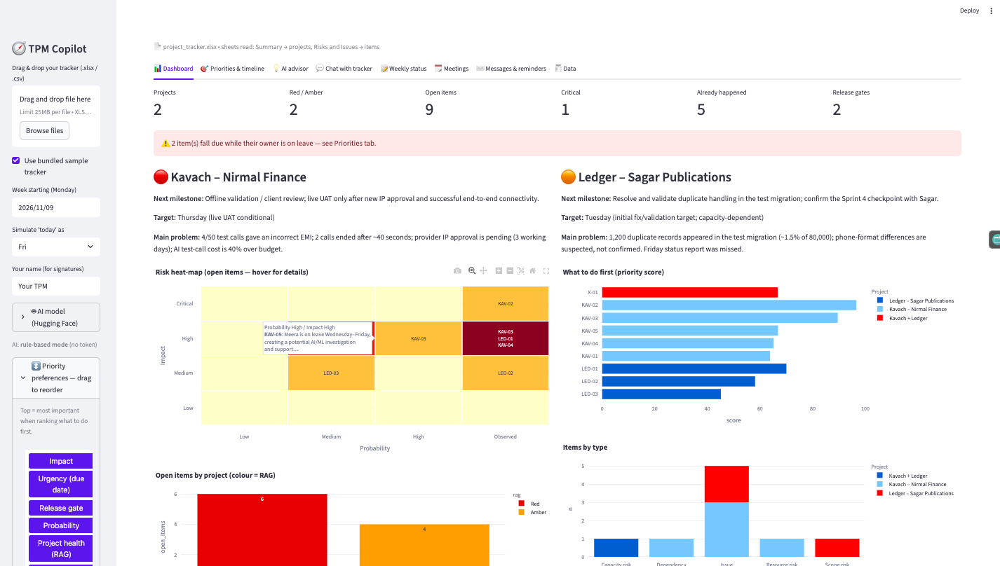
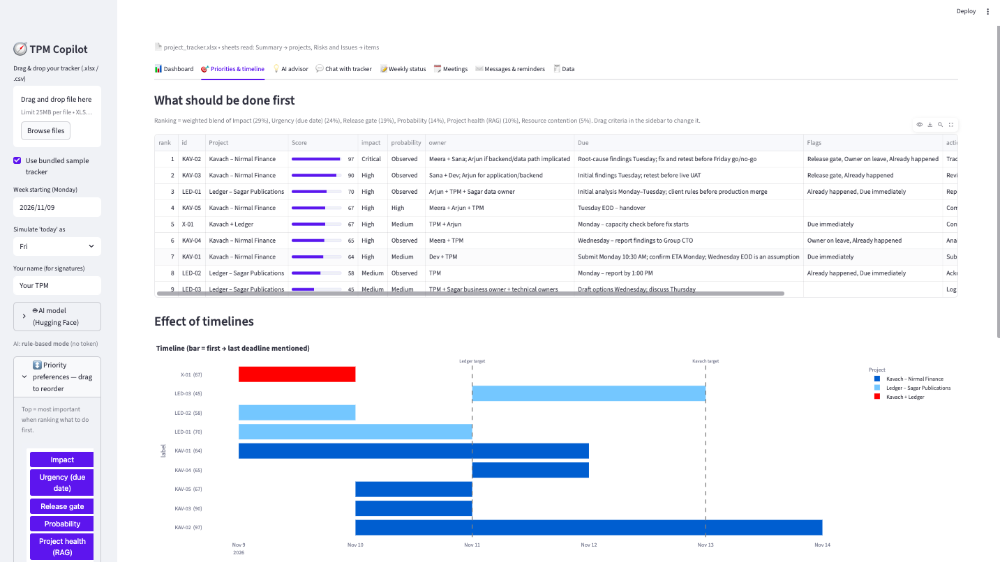
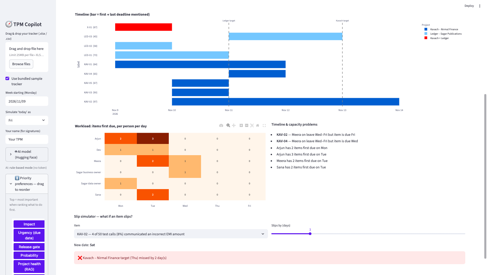
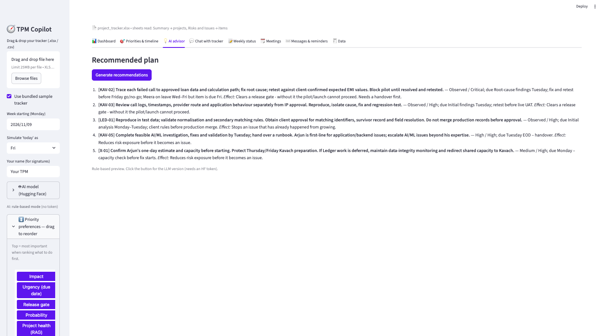
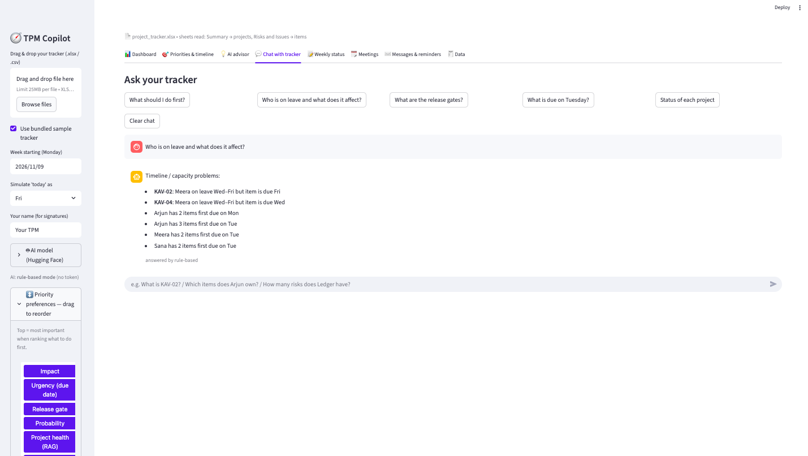
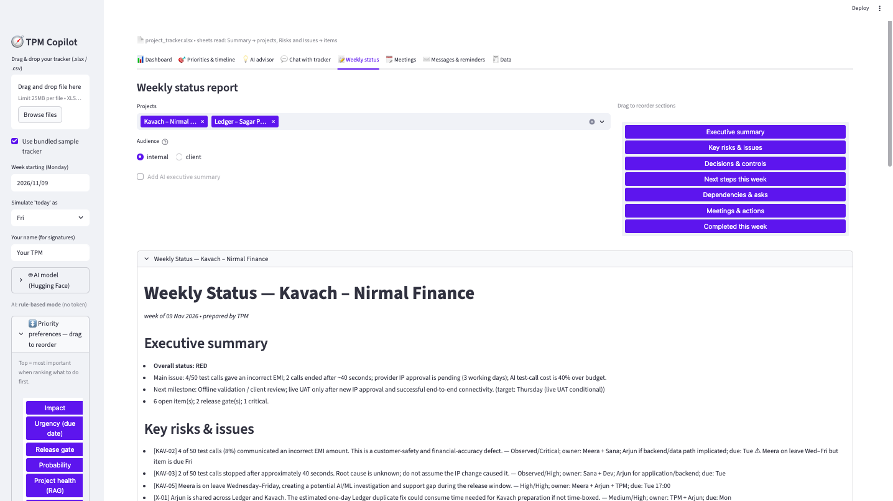
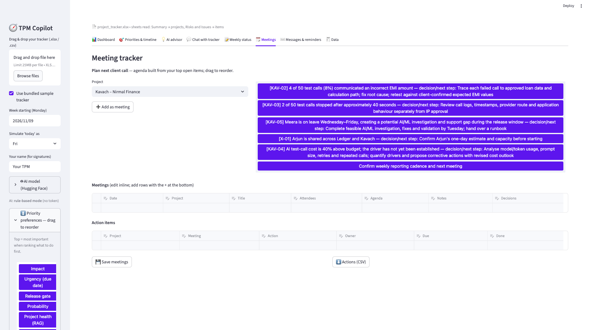
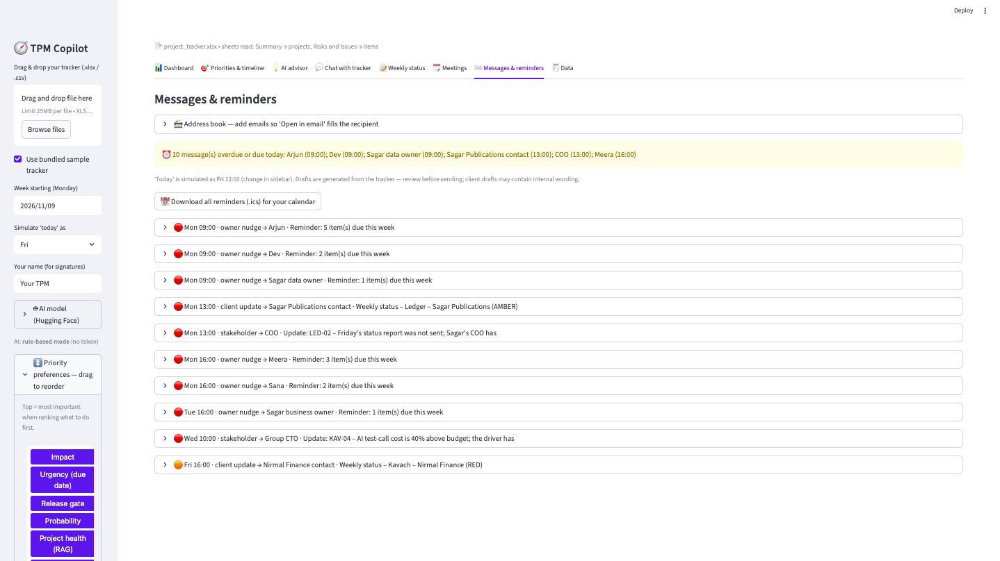
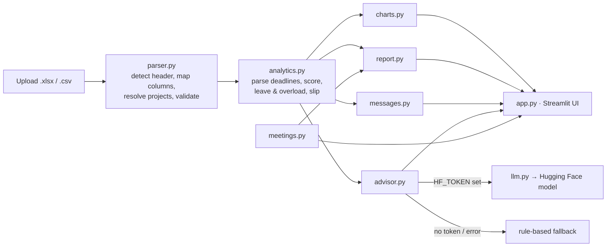

# 🧭 TPM Copilot

**Task 7 — "Build a small tool with AI"**

TPM Copilot turns a project tracker (Excel or CSV) into a working cockpit for a Technical Program Manager: analytics
and charts, a ranked **"what to do first"** list you can re-weight by drag & drop, the **effect of timelines** (leave
clashes, overloaded people, a slip simulator), LLM advice, a **chat with your tracker**, a downloadable **weekly
status report per client**, a **meeting tracker**, and **auto-drafted emails with send-by reminders**.

It was built around the Kavach × Ledger scenario from Task 5, but nothing is hard-coded to it: columns are detected
by meaning, so other trackers work too.

**Contents:** [Screenshots](#screenshots) · [Problem it solves](#the-problem-it-solves) · [Quick start](#quick-start) ·
[Features](#features-tab-by-tab) · [How it works](#how-it-works) · [Your tracker format](#what-your-tracker-should-look-like) ·
[Configuration](#configuration) · [Model choice](#model-choice-livebenchai) · [Project layout](#project-layout) ·
[Testing](#testing) · [Troubleshooting](#troubleshooting) · [Prompts used](#prompts-i-used) ·
[AI error & fix](#-one-error-the-ai-made-and-how-i-corrected-it) · [Limitations](#assumptions--limitations)

---

## Screenshots

> Add your screenshots to `docs/screenshots/` using the file names below, and they will render here automatically.
> Take them with the bundled sample tracker (sidebar → *Use bundled sample tracker*) so reviewers can reproduce them.

| # | File name | What to capture |
|---|---|---|
| 1 | `01-dashboard.png` | **Dashboard** tab: KPI row, project cards, heat-map and charts. |
| 2 | `02-priorities.png` | **Priorities & timeline** tab: ranked table with score bars. |
| 3 | `03-timeline.png` | Timeline chart + workload heat-map + "Timeline & capacity problems" list. |
| 4 | `04-drag-drop.png` | Sidebar with the draggable priority criteria (before/after reordering is ideal). |
| 5 | `05-advisor.png` | **AI advisor** tab with generated recommendations. |
| 6 | `06-chat.png` | **Chat** tab answering a question with item IDs. |
| 7 | `07-weekly-status.png` | **Weekly status** tab with the preview and the three download buttons. |
| 8 | `08-meetings.png` | **Meetings** tab with the suggested agenda and action items. |
| 9 | `09-messages.png` | **Messages & reminders** tab with an overdue banner and an open draft. |

Once the files exist, paste this block (adjust widths as you like):

```markdown









```

Tips: use a 1400px-wide browser window, hide any API token (the sidebar field is masked, but check the address bar
and chat), and avoid screenshots of real client data.

---

## The problem it solves

A TPM running several client projects spends Monday morning doing the same manual work: re-reading the tracker,
deciding what is most urgent, noticing that someone is on leave when a deadline lands, writing a status report per
client, chasing owners, and remembering which email to send when. TPM Copilot automates the *mechanical* parts and
leaves the *judgement* with you:

| Manual task | What the tool does |
|---|---|
| "What matters most today?" | Scores every open item and ranks them; you decide the weighting by dragging criteria. |
| "Will the dates hold?" | Detects owners on leave, overloaded days and what a slip does to a target date. |
| "Write the weekly report" | Generates one report per client in internal or client-safe wording, as Markdown / Word / ZIP. |
| "Who do I need to nudge, and when?" | Drafts the message and gives it a send-by time, banner reminder and calendar file. |
| "What did the tracker say about X?" | Chat answers from the data and cites item IDs. |

---

## Quick start

**Requirements:** Python 3.10+ (developed on 3.12; also run on 3.13). No GPU. Internet is only needed for the optional
AI features.

```bash
git clone <your-repo-url> tpm-copilot
cd tpm-copilot
python3 -m venv .venv
source .venv/bin/activate            # Windows: .venv\Scripts\activate
pip install -r requirements.txt
python -m streamlit run app.py       # opens http://localhost:8501
```

1. Drag your `.xlsx` / `.csv` into the sidebar upload box — or tick **Use bundled sample tracker** (the Task 5 workbook).
2. Everything works immediately in **rule-based mode** (no AI, no internet).
3. To switch on the LLM features, add a Hugging Face token
   (<https://huggingface.co/settings/tokens>). Create a **fine-grained** token and enable
   **"Make calls to Inference Providers"**; without that permission you get a 403 error.

```bash
export HF_TOKEN=hf_xxx               # or paste it into the sidebar → "AI model"
export HF_MODEL=Qwen/Qwen3-32B       # optional, see "Model choice"
python -m streamlit run app.py
```

Next time, only `source .venv/bin/activate` and the last command are needed.

---

## Features, tab by tab

### 📊 Dashboard
KPI row (projects, red/amber, open items, critical, already-happened, release gates), a card per project with its RAG
status, next milestone, target and main problem, plus four charts built from the uploaded data:

* **Risk heat-map** (probability × impact). Each cell shows the **IDs of the items in it**; hover for the ID plus a
  short description. Items whose labels don't fit the grid are listed under the chart instead of silently vanishing.
* **What to do first** — priority score bars, coloured by project.
* **Open items by project** — coloured by RAG.
* **Items by type** — risks, issues, dependencies, etc.

Items that affect more than one project (marked *Both* in the file) appear as **"Kavach + Ledger"** (built from your
project names) rather than being hidden or shown as an unexplained label.

### 🎯 Priorities & timeline
* **Ranked table** of open items with a 0–100 score bar, owner, deadline and flags (*Release gate*, *Owner on leave*,
  *Already happened*, *Due immediately*).
* **Timeline** — one bar per item from its first to last mentioned deadline, with dashed lines at each project's target.
* **Workload heat-map** — items first due per person per weekday.
* **Timeline & capacity problems** — items due while their owner is on leave, and people with ≥2 items first due the same day.
* **Slip simulator** — pick an item and a delay (0–5 days) to see the new date, which project targets are breached and
  which follow-on items get squeezed.

### ↕️ Drag & drop preferences
In the sidebar, drag the six criteria — *Impact, Probability, Urgency, Release gate, Project health, Resource
contention* — into your order. The top criterion gets the most weight and the ranking, advisor, agenda and charts update
immediately. Section order in the weekly report and the meeting agenda are draggable too.

### 💡 AI advisor
A ranked plan (max 5) with *why* each item matters and its *expected effect on the timeline*, then risks to the
timeline and decisions to escalate. With an HF token it is written by the LLM; without one you get the deterministic
version computed from the analysis. Either way the source is shown under the answer.

### 💬 Chat with your tracker
Ask in plain language: *"What is KAV-02?"*, *"What is due Tuesday for Meera?"*, *"Who is on leave and what does it
affect?"*, *"How many items does Ledger have?"*. Answers are grounded in the tracker and cite item IDs; if the data
doesn't contain the answer it says so. Quick-question buttons are provided. Works offline via rules; uses the LLM when
a token is set, and falls back to rules (with a note) if the model call fails.

### 📝 Weekly status
* One report per project, with **internal** or **client-safe** wording (the client version hides internal controls and
  owner-leave warnings).
* Sections: Executive summary · Key risks & issues · Decisions & controls · Next steps this week · Dependencies & asks ·
  Meetings & actions · Completed this week. Drag to reorder.
* Optional AI executive summary.
* **Download:** Markdown (all projects), Word `.docx`, or a ZIP with one file per client.

### 🗓️ Meetings
Meeting log and action items (tick *Done*), saved to `data/meetings.json`. **Suggest agenda** builds an agenda from the
highest-priority open items for a project (drag to reorder) and adds it as a meeting. Ticked actions appear under
*Completed this week* in the report; open actions appear under *Meetings & actions*.

### ✉️ Messages & reminders
Three kinds of drafts, each with a **send-by time**:

1. **Weekly client update** — one per project (sent earlier if a report is already overdue).
2. **Owner reminder** — one per person, the afternoon before their first deadline (Monday-due items: Monday 09:00).
   Includes a warning if they are on leave when something is due.
3. **Stakeholder escalation** — created when an item names a role (*Group CTO*, *COO*, *CEO* …); timed to the item's
   deadline (e.g. "report by 1:00 PM").

Each draft is editable, has **Open in email app** (mailto), **Polish with AI**, **Mark as sent**, and appears in an
overdue / due-today banner. **Download all reminders (.ics)** to load them into Google/Apple/Outlook calendar. The tool
never sends email itself. An address book (saved to `data/contacts.json`) fills in recipients.

### 🧾 Data
The parsed tables with every computed field, and a cleaned CSV export — useful for checking how your file was read.

---

## How it works



**Parsing.** Real trackers have banner rows, merged cells, footnotes and different layouts per sheet. The parser scans
for the row that looks most like a header, maps each column by meaning (`Tracking status`, `Due date / checkpoint`,
`Next action / mitigation` …), drops notes rows, tolerates ragged CSVs and BOMs, and resolves short project names
("Kavach") to full ones ("Kavach – Nirmal Finance"). If a sheet has no recognisable table you get a clear message, not a
crash.

**Scoring.** `score = 100 × Σ weight × factor` over six factors:

| Factor | How it is derived |
|---|---|
| Impact | Critical=4 … Low=1 |
| Probability | *Observed* (already happened)=1.0, High 0.75, Medium 0.5, Low 0.2 |
| Urgency | Sooner first deadline → higher; no date → low, never an error |
| Release gate | Text such as "block pilot", "go/no-go", "before live UAT" |
| Project health | RAG of the project (Red=1.0, Amber=0.6, Green=0.2) |
| Resource contention | How many open items the same people carry |

Weights come from your drag order (top = heaviest). Closed items score 0. The score is a transparent aid, not an oracle —
every factor is visible in the Data tab.

**Dates.** The tracker uses relative weekdays ("Tuesday", "Monday – report by 1:00 PM"). They are mapped onto the week you
choose in the sidebar (Monday = day 0). Real dates (`2026-11-11`, `11/11/2026`) also work. The first date mentioned is the
first deadline; the last is the final one. Times (`10:30 AM`, `EOD`) are used for reminder send-by times.

**Cross-project items.** A row whose project is *Both / All / Shared* applies to every project: it is included in each
project's report and workload, and shown on charts as e.g. **"Kavach + Ledger"**.

**AI grounding.** The model is given only the compact tracker text, told to answer **only** from it, cite IDs, and say
*"That is not in the tracker"* otherwise. For big trackers only the most relevant rows are sent. Reasoning-model
`<think>…</think>` blocks are stripped from replies.

---

## What your tracker should look like

Columns are matched by meaning, case-insensitively, in any order. Recognised headers include:

| Meaning | Examples of accepted headers |
|---|---|
| ID | `ID`, `Ref`, `Key`, `Ticket` |
| Project / client | `Project`, `Client`, `Account` (value `Both`/`All` = applies to every project) |
| Type | `Type`, `Category` |
| Status | `Tracking status`, `Item status`, `State` |
| Description | `Description`, `Details`, `Issue`, `Risk` |
| Probability | `Probability`, `Likelihood` (Low / Medium / High / Observed) |
| Impact | `Impact`, `Severity` (Low / Medium / High / Critical) |
| Owner | `Owner`, `Assignee`, `Responsible` (`A + B; C` = several people) |
| Next action | `Next action / mitigation`, `Action` |
| Deadline | `Due date / checkpoint`, `Due` (weekday names or real dates) |

An optional **summary sheet** with `Project`, `Status` (RAG), `Next milestone`, `Target date`, `Main problem` and
`TPM control / next decision` enriches the dashboard and reports. Without it, project health is derived from the items
and a warning tells you so. Owner leave is detected from text like *"Meera is on leave Wednesday–Friday"*.

Files that can't be understood produce a specific message (unsupported type, corrupt workbook, no item table, header only).

---

## Configuration

All settings are environment variables or sidebar fields — no code changes. Copy `.env.example` for a template.

| Variable | Purpose | Default |
|---|---|---|
| `HF_TOKEN` | Hugging Face access token (read scope) | none → rule-based mode |
| `HF_MODEL` | Model repo id | `Qwen/Qwen3-32B` |
| `HF_PROVIDER` | Hugging Face Inference Providers name | `auto` |
| `HF_BASE_URL` | OpenAI-compatible endpoint (vLLM / TGI / Ollama) for self-hosting | none |

Local files written by the app (git-ignored): `data/meetings.json`, `data/contacts.json`.

---

## Model choice (livebench.ai)

I used **[livebench.ai](https://livebench.ai)** to choose the open-weights model. On its leaderboard, filtering to
*Open weights* and the *Data Analysis* category gave this shortlist: DeepSeek V4.1 Flash, Mistral Large 4,
**Qwen3.8 27B**, GLM-5.3 Flash and MiniMax M3.1 Flash. I highlighted **Qwen3.8 27B**: open weights, a strong score, and at
27B parameters it is small enough to self-host when client data must not leave your network (use `HF_BASE_URL`).

> ⚠️ I could not verify the exact Hugging Face repo id of that newest release, so the shipped default is
> `Qwen/Qwen3-32B` — a published model from the same family that works out of the box. Put the exact repo id of whichever
> leaderboard model you choose in `HF_MODEL` (or the sidebar).

The model is used for three things only: the advisor, chat answers and optional text polish. All analytics are plain
Python, so a model outage or a wrong answer can never change a score, date or chart.

---

## Project layout

```
app.py                  Streamlit UI (8 tabs, sidebar preferences)
tpm_tool/
  parser.py             header detection, column mapping, CSV/Excel, project resolution, validation
  analytics.py          deadline parsing, scoring, leave/overload detection, slip simulator
  advisor.py            grounded chat + recommendations (LLM or rule-based) and the prompts
  llm.py                Hugging Face client (token / model / provider / endpoint via env)
  report.py             weekly status → Markdown / DOCX
  messages.py           drafts, mailto links, reminders, .ics export
  meetings.py           meeting & action tracker with JSON persistence
  charts.py             Plotly figures and tooltip helpers
tests/                  unit tests + UI smoke script + key-collision guard
sample_data/            the Task 5 tracker used during development
docs/screenshots/       put your screenshots here (see "Screenshots")
.github/workflows/      CI: runs the tests on every push
```

---

## Testing

```bash
pip install -r requirements.txt
pytest -q                      # 58 tests   (or: python tests/run_all.py — no pytest needed)
python tests/smoke_ui.py       # runs app.py end-to-end against a fake Streamlit
```

What the tests cover: messy/ragged/BOM CSVs, corrupt and empty files, duplicate and missing IDs, deadline parsing
(multiple days, times, real dates, words like "month" that must not match "Mon"), missing deadlines, closed items,
drag-order weighting, leave and overload detection, slip simulator, cross-project labelling, offline chat intents,
LLM-failure fallback, report sections and audiences, valid `.docx`/`.ics` output, mailto encoding, meeting persistence
(including a corrupt file), chart tooltip wrapping/escaping, heat-map cell contents, and a static guard that no
Streamlit widget key collides with a session-state key.

Not covered: pixel-level rendering of charts and the real Streamlit/Hugging Face services (the smoke script uses stand-ins,
and LLM calls are tested with a fake model). Do a quick visual check in a browser after installing.

---

## Troubleshooting

| Symptom | Fix |
|---|---|
| `zsh: command not found: streamlit` | Activate the venv (`source .venv/bin/activate`) and run `python -m streamlit run app.py`. |
| `pip install` fails on an old Python | Use Python 3.10+ (`python3 --version`). |
| Drag & drop list doesn't reorder | Confirm `pip show streamlit-sortables`; the app falls back to the default order and shows a caption. |
| "AI: rule-based mode" | No token set. Add `HF_TOKEN` or paste it in the sidebar → *AI model*. |
| "LLM unavailable: …" under an answer | Model not served by your provider or quota hit — try another `HF_MODEL`; the rule-based answer is shown meanwhile. |
| Upload says "No item/risk table found" | Check the header row has at least two recognised columns (see the table above). |
| Dates look a week off | Set **Week starting (Monday)** in the sidebar to the week the tracker describes. |
| Reminders show overdue unexpectedly | Change **Simulate 'today' as** in the sidebar. |

---

## Prompts I used

All code was written with an AI assistant (Claude). In order:

**1. Main build prompt — written as a TPM build brief**

*Structured from my original request. The exact wording I sent is in the collapsible block below.*

> **Role.** You are a senior developer who ships production-quality apps and designs for edge cases and test
> coverage up front.
>
> **Context.** I'm a Technical Program Manager running multiple client projects (Task 5 tracker: Kavach, Ledger).
> Every Monday I manually re-read the tracker, decide priorities, check whether dates hold, write one status
> report per client, and chase owners. This is repetitive, error-prone and time-consuming.
>
> **Objective.** Build a tool that turns the tracker into a decision-ready weekly status — per client — and tells me
> what to do first, what is at risk on the timeline, and who I need to message and when.
>
> **Functional requirements (each is a pass/fail acceptance criterion)**
>
> | # | Requirement | Acceptance criteria |
> |---|---|---|
> | R1 | **Intake** | I can upload the tracker as `.xlsx` or `.csv`; the bundled Task 5 workbook must parse correctly. |
> | R2 | **Analytics** | Statistics and graphs come from the *actual uploaded data*, using open-source libraries; comprehensive, not a static mock-up. |
> | R3 | **Preferences** | I can change priorities using **drag and drop**, and the ranking updates immediately. |
> | R4 | **Timeline & priority** | Show the *effect of timelines* and **what should be done first**. |
> | R5 | **LLM guidance** | An LLM recommends how to proceed and *how it will be effective* — grounded in the tracker, no invented facts. |
> | R6 | **Chat** | I can ask questions about the spreadsheet in natural language and get answers that point to the source items. |
> | R7 | **Weekly status** | A weekly status report is generated for each client and I can **download it**. |
> | R8 | **Meeting tracker** | I can log meetings, decisions and action items. |
> | R9 | **Messages & reminders** | Draft emails/messages from project and feature status, and **remind me to send** each to the right person at the right time. |
>
> **Constraints.** Open-source model from Hugging Face. Select it from the livebench.ai open-weights leaderboard
> shortlist (DeepSeek V4.1 Flash, Mistral Large 4, Qwen3.8 27B, GLM-5.3 Flash, MiniMax M3.1 Flash) and **call out
> in the project that livebench.ai was used to choose the model.**
>
> **Quality bar.** Treat edge cases as requirements, not extras: missing dates, empty or corrupt files, duplicate IDs,
> ragged CSVs, unrecognised labels, and the model being unavailable (the tool must degrade gracefully, never show
> a broken screen). Include automated tests.
>
> **Deliverables.** Code in a GitHub repository; a README with run instructions, the prompts used, and **one error
> the AI made and how I corrected it**.
>
> **How I'll review.** I will run it on my real tracker, challenge every output against the source data, and
> report defects back to you for fixing.

<details>
<summary>My original message, as I sent it</summary>

> You are a great developer who develops apps considering all the test cases. *[Task 7 text: build a small tool that
> saves time for a TPM; read the tracker (CSV/Excel) and make a weekly status report for each client; put code on
> GitHub with a README with prompts + one AI error and the fix.]* The tool should have:
> 1. user is able to upload the excel or csv file.
> 2. Internally, some open source library analyses the excel file and creates statistics and graphs from the actual
>    data. It should be comprehensive with drag-and-drop functionality to change the preferences. Also, it should show
>    the effect of timelines and what should be done first. It should have LLM suggestions on how to proceed and how it
>    can be effective.
> 3. Add chatbot functionality where the user can ask questions about the excel sheet.
> 4. It should create a weekly status, have a meeting tracker, create an email or message based on the project/feature
>    status and remind me to send it to the respective person.
> 5. At the end, I should be able to download the weekly status.
> Use a Hugging Face open-source model; pick from this livebench.ai list (…) and highlight in the project that
> livebench.ai was used to find the model.

</details>

**2. In-app system prompts** (shipped in `tpm_tool/advisor.py`):

*Chat:* "You are a TPM assistant answering questions about ONE project tracker. Use ONLY the tracker data provided. Cite
item IDs in brackets like [KAV-02]. If the answer is not in the data, say 'That is not in the tracker.' Never invent
dates, owners or numbers. Be concise."

*Advisor:* "You are a senior Technical Program Manager coach. Using ONLY the tracker data and the computed analysis
provided, recommend what to do first and how to proceed effectively. Output: 1) a ranked 'Do first' list (max 5) with
the reason and the expected effect on the timeline; 2) 'Risks to the timeline' (leave, capacity, dependencies); 3)
'Decisions to escalate'. Cite item IDs. Do not invent facts. Keep it under 350 words."

**3. Follow-up prompts** (hardening and fixes after running it): *"ValueError: items must be list[str]…"*,
*"StreamlitAPIException: st.session_state.order cannot be modified after the widget … is instantiated"*, *"when I hover
it stretches"*, *"the heat-map doesn't say which items are impacted — add the items"*, *"I don't understand the need
for ALL, remove it from the graph"*, *"update the README and make it more comprehensive"*.

---

## ❗ One error the AI made, and how I corrected it

**The error — silent data loss on CSV upload.** The first version of the parser read CSVs with
`pd.read_csv(..., header=None, on_bad_lines="skip")`. pandas sizes the table from the *first line*. My test file had a
short banner row (`My tracker,,,,`) above a wider header, so pandas treated every real row as "bad" and **skipped them
without any error** — the tool loaded, showed an empty or truncated report, and nothing looked wrong. The AI added
`on_bad_lines="skip"` to stop a crash and never considered what it hides.

**How it was caught:** the edge-case test `test_csv_with_banner_and_different_column_order` failed with "No item/risk
table found". Reproducing it with 25 rows showed them vanishing.

**The fix:** `_read_ragged_csv` in `parser.py` reads every row with the stdlib `csv` module (handles BOM, quotes and
commas inside cells), pads short rows to the widest row, and never skips anything. Regression tests
`test_ragged_csv_never_drops_rows` and `test_csv_with_bom_quotes_and_commas_in_cells` lock it in.

**Other AI slips found the same way** (all fixed, all covered by tests):

* A deadline column that became floats with NaN when one deadline was missing, crashing the day labels.
* Duplicate entries in the drag-order silently overriding ranks.
* Filler words ("the", "what") making unrelated chat questions match tracker rows.
* Overwriting a Streamlit widget's session key *after* the widget was created (an exception), now done in a callback.
* Found when I ran it: the drag-and-drop component rejecting its own previous output (now validated in and out), and a
  widget key reused as a session-state key (now prevented by a guard test).
* Found when I used it: tooltips stretching with long text (now wrapped), a heat-map that only showed counts (now shows
  item IDs), and an internal `ALL` label leaking into charts, chat and emails (now shown as the real project names).

The lesson I took: AI-written code passes the happy path; the bugs live in empty values, odd shapes and framework rules,
so I asked for edge-case tests first and re-ran the real app after every change.

---

## Assumptions & limitations

* Probability and impact are the TPM's own judgements from the tracker; the score is an aid, not an oracle.
* The tracker has no "completed" column, so *Completed this week* comes from ticked meeting actions.
* Draft messages are built from tracker text, which may contain internal wording — **review before sending**. The tool never
  sends email itself; it opens your mail client and gives you calendar reminders.
* Browser push notifications aren't possible from a local Streamlit app; reminders are the in-app banner plus `.ics`.
* Owner, leave and role detection is pattern-based (e.g. *"X is on leave Wednesday–Friday"*); unusual phrasing is missed.
* With an LLM enabled, tracker text is sent to the Hugging Face provider you configure. For confidential data use
  `HF_BASE_URL` with a self-hosted model.
* Meetings and contacts are stored in local JSON files — fine for one person, not a multi-user system.

## Ideas for next steps

Read live from Jira / Google Sheets, send emails through an authenticated mailbox, week-over-week trend charts from
stored snapshots, a "what changed since last week" section, and confidence/explanations per score factor in the UI.
